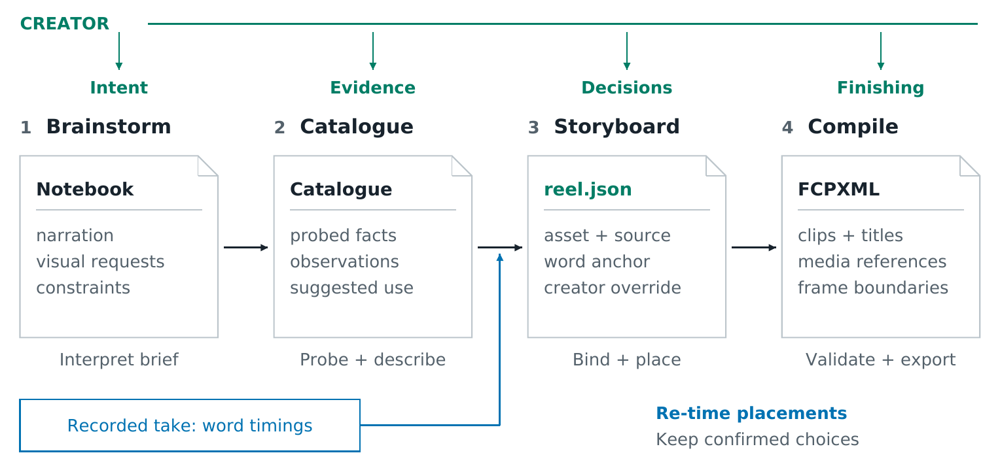
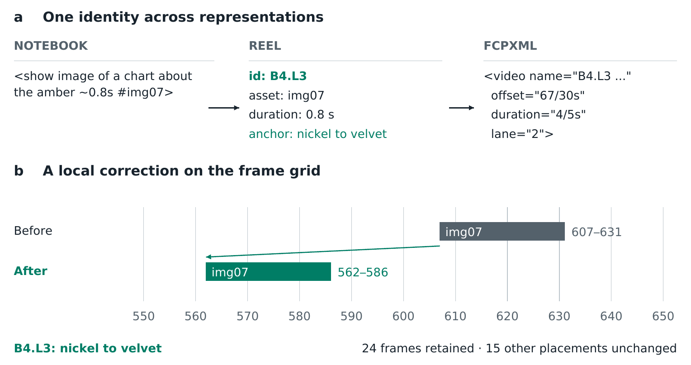

# REAL: representations and correction

REAL supports short narrated explanations assembled from footage, diagrams
and voice. Each stage produces a persistent artifact a creator can inspect
before translation continues (Figure 1). The design follows documented
production failures rather than a formal formative study: expose a decision
where its cause can be corrected, separate observations from recommendations,
and retain confirmed choices across rebuilds.

{width=100%}

A skill combines dialogue instructions, scripts and a handoff format. The host
selects the model; no foundation model is built into the four skills. Models
interpret media and requests; scripts parse the notebook, probe files, bind
assets, derive timing, apply revisions and validate export. The structural tests
use supplied descriptions and word times, with no model calls.

## Intent and evidence

A notebook groups typed components into *beats*: narration spans with associated
visuals and sounds. Production notes stay outside the narration clock. Requests
can specify duration, asset tags and optional status without project-file syntax.
This prevents a stage direction from silently becoming spoken time.

Cataloguing records duration, dimensions, frame rate, rotation and audio streams.
The production scanner samples 16 evenly spaced frame centres by default;
timestamped observations state their inspection coverage. Model descriptions and
suggested uses remain distinct from probed facts and can be corrected before
binding. Stable asset identifiers preserve references after renaming.

The lexical binder combines explicit tags, declared associations and weighted
term overlap, enforcing media-kind compatibility and minimum content evidence.
Explicit tags receive priority; type compatibility alone cannot establish a match.
Contributing signals and alternatives remain inspectable (Figure 2). Unresolved
matches become visible requests or placeholders. An optional grounding stage
selects source-event boundaries from ordered observations, records alternatives
and refuses unknown or uninspected evidence. Sampling does not establish
continuous coverage or precise motion boundaries.

Strongest matches bind first; notebook order and stable asset identifiers break
ties. These heuristics make a choice reproducible and challengeable. Their
semantic quality is not established by the tagged assembly test.

{width=100%}

## Timing and decision ownership

The storyboard is the authoritative edit. Each visual layer records identity,
asset, source interval, word anchor, requested duration, style and selector.
Audio lanes distinguish narration, source sound, music and effects. The tracks
view exposes selected assets and alternatives; edits produce named revision
commands rather than an unrecorded replacement of the whole plan.

A *word anchor* identifies a narration token whose time can change. An estimated
clock supports planning before recording; a measured clock aligns words to a
take. Updating the clock derives new placement times without selecting content
again. Creator ownership marks accepted choices that `build --preserve` retains;
unrecognized revisions and conflicting choices remain explicit errors.

For word $i$, the default inline cue is $s_i+0.4(e_i-s_i)+\delta$, where
$s_i,e_i$ are word bounds and $\delta$ is the creator's offset. Base shots start
at the beat boundary. Nearby cues may start together within a 0.3-second window
unless the creator marks one to keep its separate timing;
explicit holds extend a beat, while ordinary overlays clip to its available span.
The requested duration remains separate so an earlier re-anchor can recover it.
A pause policy can hold the base shot until the next beat, subject to source
length. These are declared pacing conventions, not learned optimal choices.

Derived times retain precision until export. Absolute boundaries map to frames
with Python's ties-to-even rule; duration is the difference of rounded end and
start, not a separately rounded length. This avoids a subtle defect: rounding
9.2498 seconds to milliseconds crosses a half-frame boundary at 30 fps.

## Correction and export

In the synthetic walkthrough, `B4: L3 anchor = velvet` moves the same `img07`
layer from frames 607–631 to 562–586 at 30 fps (Figure 3). Its requested duration
remains 0.8 seconds; the other 15 non-gap placements keep their identities and
boundaries, and the new anchor survives rebuilding. The unusual words are test
inputs. This demonstrates the implemented correction path, not participant
performance.

{width=100%}

The compiler checks structure, assets, source bounds and text classification
before translating visuals, overlays, titles and audio. Parity checks detect dropped elements; XML checks cover
references, frame alignment and timebases. It refuses unresolved decisions
rather than inventing editorial replacements. Target conventions still matter:
Final Cut positions are percentages of project height, requiring conversion
from pixel layout [@apple-animation]. A development import exposed this error
in both exporter and local reader, despite their mutual agreement.

## Recorded-content case

A Paganini lesson complements the synthetic trace with spontaneous speech.
A review of the tracks page by the assisting model proposed eight overlay re-anchors to associate captions and
stills with named phrases while retaining five base clips. These
are proposed editorial choices, not participant repairs. The final export
contains the three finished stills and supplied performance opening; its
verification script confirms that all 18 tutorial placement and source records
shift by exactly 419 frames for the intro. The creator reports that the opening, stills, captions
and audio play correctly in Final Cut, including visible Glow. This is a
single-project observation, not systematic compatibility evidence.

The case exposed two upstream limits. A project adapter was needed to express
narration inside a supplied footage excerpt; downstream source-window support
does not by itself solve that notebook authoring gap. PocketSphinx failed on
two of five takes with out-of-vocabulary words. On the other three, median
onset disagreement with Whisper was 60–90 ms; the largest disagreement was
3.49 seconds on “our” in the fourth take (7.83 versus 4.34 seconds).
The project used Whisper word times as its measured clock. Neither ASR source
was checked against manual acoustic annotations, so this is a documented
fallback and disagreement, not an aligner-accuracy benchmark.
